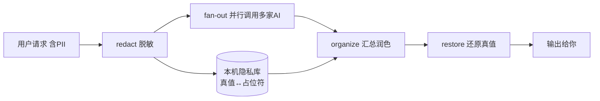

# AI Router · 多模型智能路由 + 隐私中转站

> 把每个问题按任务类型自动分类，派发给当前最强的大模型（豆包 / DeepSeek / Kimi / 通义千问 / 智谱 GLM / 腾讯混元 / Gemini / GPT / Claude），并支持多模型对比与投票。内置**隐私中转站**：姓名、电话、邮箱等敏感信息先本地脱敏，外部 AI 只见占位符，结果汇总后再还原给你。

这是一个 **WorkBuddy 技能（Skill）**，定位为「AI 聚合路由层 + 隐私中转站」：你只管提问，它充当裁判（Judge）判断任务类型，把任务交给最合适的大模型；若含隐私，先脱敏再分发、汇总后还原，全程外部 AI 看不到你的真实信息。

## 特性

- 🧭 **裁判模型动态路由**：按任务类型（编程 / 中文 / 推理 / 长文 / 视觉 / 结构化 / 性价比 / 联网）自动选最优模型
- 🔌 **统一接入**：豆包、DeepSeek、Kimi、通义、智谱、混元、Gemini、OpenAI、Claude、文心一言，一套脚本全部打通
- 🔑 **两个聚合平台驱动**：火山方舟 + 腾讯云 TokenHub，两个 Key 覆盖 180+ 模型，无需逐家申请官方 Key
- 🪶 **零依赖**：调用脚本仅用 Python 标准库，无需 `pip install`
- 🔍 **接入自检**：一条命令判断 Key 是否有效、站点/项目是否匹配、模型 ID 是否过期
- 🗳️ **多模型对比 / 投票**：一键让多个模型同时回答并汇总；`--vote` 让裁判打分选最优
- 📊 **费用与用量统计**：本地记录每次调用的 token 数与估算费用（CNY），相同请求可走缓存省额度
- 🛡️ **失败重试 + 跨模型降级**：限流/5xx 指数退避重试，401/402 立即切备用模型，推理模型空正文自动扩容重试
- 🌊 **流式输出**：`--stream` 边生成边打印，隐私占位符跨 chunk 也能正确还原
- 🧪 **52 项单测 + GitHub Actions CI**：脱敏往返、降级链、缓存、打包密钥扫描全覆盖
- 🔧 **易扩展**：加一个新供应商只需改几行配置

## 支持的供应商

| 供应商 | 默认模型 | 擅长 |
|---|---|---|
| 豆包（火山方舟） | doubao-seed-evolving | 中文、性价比 ✅ 已实测 |
| DeepSeek | deepseek-flash | 代码、推理（余额 0，待充值） |
| Kimi（月之暗面） | kimi-k3.1-pro | 长文本 / 1M 上下文 |
| 通义千问 | qwen3.7-plus | 中文、结构化 |
| 智谱 GLM | glm-5 | 中文、代码 |
| 腾讯混元（TokenHub） | hy4-preview | 一个 Key 覆盖 120+ 在线模型 ✅ 已实测 |
| Gemini | gemini-2.5-flash | 长上下文、视觉 |
| OpenAI | gpt-5.1 | 综合、推理 |
| Claude | claude-sonnet-5-5 | 编程、长文 |
| 文心一言（可选） | ernie-4.0-8k | 中文（未核实） |

> 2026-11-05 已按各家官方文档全量更新默认模型 ID（旧值 `gpt-4o` /
> `claude-3-5-sonnet` / `gemini-2.0-flash` / `glm-4-plus` / `moonshot-v1-8k` /
> `qwen-plus` / `hunyuan-pro` 均已过时）。腾讯混元老端点 2026-09 停服，现走 TokenHub。
> 详见 [`references/models.md`](references/models.md) 的「核实状态」。

详细端点与模型清单见 [`references/models.md`](references/models.md)。

**两个聚合平台的别名**（共用各自的 Key，无需单独申请）：

| 平台 | 别名 | 数量 |
|---|---|---|
| 火山方舟 `ARK_API_KEY` | `ark-deepseek` / `ark-kimi` / `ark-glm` | 55 模型 |
| 腾讯云 TokenHub `HUNYUAN_API_KEY` | `th-code` / `th-deepseek` / `th-flash` / `th-kimi` / `th-glm` / `th-minimax` | 126 模型 |

这些别名**均已纳入自动路由**。详见[「进阶：两个聚合平台」](#进阶两个聚合平台一个-key-覆盖多家模型)。

## 安装（作为 WorkBuddy 技能）

技能目录即本仓库根目录。将其放入：

- **用户级**（跨所有项目）：`~/.workbuddy/skills/ai-router/`
- **项目级**（团队共享）：`<项目>/.workbuddy/skills/ai-router/`

放入后，在 WorkBuddy 对话中直接说「用最好的 AI 帮我…」「路由这个问题」「问豆包…」即可触发。

## 配置

1. 复制配置模板并填入密钥：

   ```bash
   cp .env.example .env
   # 编辑 .env，填入你启用的供应商 API Key
   ```

2. 也可直接在 shell 中 `export` 对应环境变量（见 `.env.example`）。

`.env` 由 `scripts/env_loader.py` 自动加载（纯标准库，无需安装 `python-dotenv`）；已存在的环境变量优先级更高。

未配置密钥的供应商会在路由时被自动跳过，向下取下一个可用模型。

## 密钥在哪找

API Key 都在各家的「开放平台 / 控制台」，流程基本一致：注册 → 实名认证 → 创建 API Key。

| 供应商 | 申请地址 | 特别说明 |
|---|---|---|
| 豆包（火山方舟） | https://ark.volcengine.com/region:cn-beijing/apiKey | 每个模型 50 万 token 免费额度，未开通也能先试；用完再开通转付费 |
| DeepSeek | https://platform.deepseek.com/api_keys | 需先充值，无免费额度；余额不足报 402 |
| Kimi（月之暗面） | https://platform.moonshot.cn/console/api-keys | — |
| 通义千问（阿里云百炼） | https://bailian.console.aliyun.com/ | 在「API Key 管理」创建 |
| 智谱 GLM | https://open.bigmodel.cn/usercenter/proj-mgmt/apikeys | 新用户常有免费额度 |
| 腾讯混元（TokenHub） | https://console.cloud.tencent.com/tokenhub/apikey | 老混元平台 2026-09 停服；国内端点 `tokenhub.tencentmaas.com/v1`（**无 cloud**），写错会报 401002 |
| 文心一言（百度千帆） | https://console.bce.baidu.com/qianfan/ | 应用接入 → API Key |
| Google Gemini | https://aistudio.google.com/app/apikey | 有免费额度；国内访问需自行解决网络 |
| OpenAI | https://platform.openai.com/api-keys | 需绑定境外支付方式 |
| Anthropic Claude | https://console.anthropic.com/settings/keys | 需预充值 |

**最容易踩的坑**

1. **豆包**：
   - API Key 与控制台**左下角的项目空间**绑定，换项目后 Key 不通用（401 的首要原因）。
   - **2026-09-17 之后创建的 Key 改用新明文格式**，旧 Key 继续有效；别靠 `sk-` / UUID 前缀猜归属，以创建它的控制台为准。
   - 模型 ID 周级换代。当前推荐 `doubao-seed-evolving`；官方示例用 `doubao-seed-2-1-pro-260915` 这类带日期的完整 ID。**不存在 `doubao-seed-evolving-latest-version`**。报「模型不存在」时用 `check_provider.py --scan` 查。
2. **TokenHub 域名**：国内站点是 `tokenhub.tencentmaas.com`（**没有 `cloud`**）。
  `tokenhub.tencentcloudmaas.com` 是另一站点，用国内 Key 访问会返回
  `401002`「Key 与 Base URL 不属于同一站点」。国际站 / 硅谷站 Key 也不通用。
3. **Key 只显示一次**：创建完立刻复制保存，关掉弹窗后无法再查看完整 Key，丢了只能重建。
4. **DeepSeek 要充值**：没有免费额度，余额不足会直接 402，先小额充值即可。
5. **国内平台需实名认证**：个人实名一般几分钟；企业认证更慢。

**建议的最小可用组合**：方舟 `ARK_API_KEY` + TokenHub `HUNYUAN_API_KEY` 两个 Key，
已能覆盖豆包 / 混元 / DeepSeek / Kimi / GLM / MiniMax / Step 等全部主流国内模型。
DeepSeek 官方 Key 只是可选项。

更完整的端点与模型清单见 [`references/models.md`](references/models.md)。

## 接入豆包（分步）

> **打开链接看到 404？** 见下方[「控制台 404 排障」](#控制台-404-排障)。这些控制台都是单页应用，服务器返回 200、只有前端路由渲染出 404，不代表服务不可用。

1. 打开 https://console.volcengine.com/ark ，用手机号注册并完成**实名认证**（未实名时搜不到模型）。
2. 记下控制台**左下角的项目空间名**（通常是 `Default`）——创建 Key、开通模型、调用 API 必须在同一项目下。
3. 开通模型：https://console.volcengine.com/ark/region:cn-beijing/openManagement → 建议勾选「全选 + 自动开通新增模型」。新用户每个模型有 **50 万 token 免费额度，未开通也能先调用**；额度用完后在此开通即转按量付费。
4. 创建 Key：https://ark.volcengine.com/region:cn-beijing/apiKey → 「创建 API Key」→ **立刻复制**（只完整显示一次）。
5. 填入技能根目录的 `.env`：

   ```bash
   ARK_API_KEY=你的方舟Key
   ```

6. 自检（推荐，一次区分 Key 无效 / 项目不匹配 / 模型 ID 过期）：

   ```bash
   python scripts/check_provider.py --provider doubao --scan
   ```

   脚本会拉取方舟**官方公开模型目录** `https://ark.volcengine.com/models.json`（无需 Key），列出当前有效的豆包 LLM 模型 ID，再逐个探测候选 ID。若与默认不同，调用时加 `--model 模型ID` 覆盖。

7. 试跑：

   ```bash
   python scripts/call_model.py --provider doubao --prompt "写一条小红书文案"
   ```

> 方舟也支持用「推理接入点」ID（`ep-` 开头）作为 model 值；日常直接用模型 ID 更简单。
> 调用端点是 `https://ark.cn-beijing.volces.com/api/v3`（数据面），鉴权 `Authorization: Bearer $ARK_API_KEY`。

### 控制台 404 排障

截图里那种「404 / 当前页面无法访问 / 可能由于网址已删除或尚未生效」页面，通常是**控制台 SPA 的前端路由 404**，不是域名失效（2026-11-05 实测上述入口 HTTP 均返回 200）。按顺序试：

1. **换直链**：不要用旧书签或搜索结果里的深层链接，直接用下表地址。
2. **先登录**：未登录时访问需鉴权的具体页面，前端常直接落到 404。先访问首页登录，再点左侧菜单。
3. **选项目空间**：控制台左下角切换到一个具体项目（如 `Default`）。
4. **清缓存**：`Ctrl+F5` 强刷，或用无痕窗口；排除旧 cookie / 浏览器插件干扰。
5. **换文档域名**：控制台打不开时，`ark.volcengine.com` 文档站是独立站点，可直接查步骤与模型列表。

| 用途 | 已验证直链 |
|---|---|
| 方舟首页 | https://console.volcengine.com/ark |
| API Key 管理 | https://ark.volcengine.com/region:cn-beijing/apiKey |
| 开通管理 | https://console.volcengine.com/ark/region:cn-beijing/openManagement |
| 快速入门文档 | https://ark.volcengine.com/region:cn-beijing/docs/quick-start.md |
| 模型列表文档 | https://ark.volcengine.com/region:cn-beijing/docs/model-list.md |
| 官方模型目录 JSON | https://ark.volcengine.com/models.json |

## 使用

**0. 接入自检（新增供应商后先跑）**

```bash
python scripts/check_provider.py --provider doubao          # 诊断当前配置
python scripts/check_provider.py --provider hunyuan --scan  # 列出 TokenHub 可用模型
```

**1. 自动路由（裁判模式）**

```bash
python scripts/judge.py --prompt "帮我用Python写个爬虫"
# 输出：task_type=code, recommended={provider: th-code, model: kimi-k2.7-code}
```

```bash
python scripts/call_model.py --provider th-code --prompt "帮我用Python写个爬虫"
```

**2. 直接指定模型**

```bash
python scripts/call_model.py --provider doubao --prompt "写一条小红书文案"
```

**3. 用 LLM 当裁判（语义分类）**

```bash
python scripts/judge.py --prompt "总结这篇论文的核心贡献" --use-llm
```

**4. 多模型对比**

```bash
python scripts/call_model.py --provider th-deepseek --prompt "解释一下量子纠缠"
python scripts/call_model.py --provider doubao      --prompt "解释一下量子纠缠"
```

## 进阶：两个聚合平台，一个 Key 覆盖多家模型

接入后发现，方舟与腾讯云 TokenHub 都是"一个 Key、一个 OpenAI 兼容端点、几十到上百个模型"的聚合平台，**共用各自的 Key**，不必再去 Kimi / 智谱 / DeepSeek / MiniMax 各家单独申请。

```bash
python scripts/check_provider.py --provider doubao  --scan   # 方舟：55 模型
python scripts/check_provider.py --provider hunyuan --scan   # TokenHub：126 模型 / 120 online

python scripts/call_model.py --provider th-code      --prompt "写个快速排序"
python scripts/call_model.py --provider th-kimi      --max-tokens 2048 --prompt "总结这段长文"
python scripts/call_model.py --provider ark-deepseek --prompt "写个快速排序"
python scripts/call_model.py --provider doubao       --prompt "写一条小红书文案"
python scripts/call_model.py --provider hunyuan --model hy-vision-2.0-instruct --prompt "..."
```

| 平台 | 别名 | 默认模型 ID | 实测 |
|---|---|---|---|
| 方舟 | `ark-deepseek` | `deepseek-v4-1-flash-261017` | ✅ |
| 方舟 | `ark-kimi` | `kimi-k3-1-pro-261024` | ✅ |
| 方舟 | `ark-glm` | `glm-5-3-flash-260828` | ✅ |
| TokenHub | `th-code` | `kimi-k2.7-code` | ✅ |
| TokenHub | `th-deepseek` | `deepseek-v4-pro-202606` | ✅ |
| TokenHub | `th-flash` | `deepseek-v4.1-flash` | ✅ |
| TokenHub | `th-kimi` | `kimi-k3.1-pro` | ⚠️ 推理模型，需较大 max-tokens |
| TokenHub | `th-glm` | `glm-5.3-flash` | ✅ |
| TokenHub | `th-minimax` | `minimax-m3.1-flash` | ✅ |

这些别名已纳入 `judge.py` 的自动路由：代码 → `th-code`，推理 → `th-deepseek`，
长文 → `th-kimi`，中文 → 豆包 / 混元。因此「DeepSeek 官方 Key 余额为 0」不再导致
代码任务 402。想恢复原策略，改 `judge.py` 的 `ROUTING` 即可。

> **TokenHub 端点注意**：国内站 `https://tokenhub.tencentmaas.com/v1`（无 `cloud`）。
> 写成 `tokenhub.tencentcloudmaas.com` 会报 `401002`「Key 与站点不匹配」。
> 模型需先在控制台开通服务，未开通返回 402。
>
> **推理模型**：`ark-deepseek` / `ark-kimi` / `th-kimi` 会先输出 `reasoning_content`；
> 把 `--max-tokens` 设得过小（如 20）会导致正文为空，默认值 2048 足够。
>
> 模型 ID 带日期后缀且周级迭代，`/models` 里列出的也不保证都有权限
> （例如 `doubao-seed-2-0-code-preview-260215` 实测 404）。变更前用 `--scan` 复核。

## 隐私中转站（Privacy Relay）

把 WorkBuddy 变成**隐私代理**：发来的内容里含姓名 / 电话 / 邮箱 / 身份证 / 银行卡 / 地址等敏感信息时，**只把真值存进本机 SQLite 隐私库，对外只发占位符文本**，多家 AI 在脱敏状态下并行处理，结果由另一个模型汇总润色后，再把占位符还原成你的真实信息再输出。外部 AI **全程看不到任何真实 PII**。



```bash
# 自动路由到 top-2 模型 → 汇总 → 还原 PII
python scripts/relay.py --prompt "帮客户张伟(电话13800138000)写封跟进邮件"

# 显式指定两家并发，跳过汇总（直接拼接）
python scripts/relay.py --prompt "..." --providers doubao,th-flash --no-organize

# 跑所有已配置供应商再合并
python scripts/relay.py --prompt "..." --all

# 启发式姓名/地址脱敏（默认只做高置信检测）
python scripts/relay.py --prompt "..." --strict

# 自定义必脱敏词（如内部代号）
python scripts/relay.py --prompt "..." --custom "张三,项目代号X"

# 复用同一隐私库会话（同一机密话题的连续对话）
python scripts/relay.py --prompt "..." --session <session_id>
```

**管线**：`脱敏 → 多家并发 → 汇总润色 → 还原 → 输出`。汇总模型被明确要求**原样保留所有占位符**，因此还原是精确的。

**本地隐私库管理**（全部本机、仅属主可见）：

```bash
python scripts/privacy.py --list                 # 列出会话与脱敏计数
python scripts/privacy.py --export --session <id> # 审计某会话的映射
python scripts/privacy.py --clear  --session <id> # 删除单个会话
python scripts/privacy.py --clear-all             # 清空整个库
```

**检测等级**
- **默认（高置信）**：邮箱、手机号（CN）、18 位身份证、16–19 位银行卡、IPv4、QQ 号，以及 `--custom` 指定的任意词。
- **`--strict`**：追加启发式姓名 / 地址匹配（可能过度脱敏，适合已知含姓名地址的场景）。

占位符形如 `PII_EMAIL_1`，**只存在于本机隐私库**，已被 `.gitignore` 排除、也不会进入打包 zip。

> ⚠️ **安全边界**：隐私库是明文 SQLite 文件，与 `.env` 同等敏感——本机不要共享该文件；公开仓库前先 `privacy.py --clear-all`。它防的是"外部 AI 拿到你的隐私"，不防"本机被入侵 / 误提交"。

## 可靠性与容错（Retry / Fallback）

这不是纸上功能——某一轮「把项目发给所有 AI 评审」时，12 路并发里 5 路直接报废：限流读超时、`ark-kimi` 服务端 500、`deepseek` 余额 402、两个推理模型正文为空。现在这些都有兜底。

**错误分类（决定「重试」还是「换人」）**

| 情况 | 例子 | 处理 |
|---|---|---|
| 限流 / 服务端抖动 / 网络超时 | 429、5xx、read timeout | 指数退避重试（默认 3 次，1s→2s→4s） |
| 认证失败 / 余额不足 / 模型不存在 | 401、402、403、404 | **不浪费次数**，立刻切备用模型 |
| 推理模型空正文 | `reasoning_content` 吃光 token | 自动把 `max_tokens` 翻倍重试一次（上限 8192） |

**备用链（按供应商交叉配置，避免同一家整体故障）**

```text
doubao → ark-deepseek → th-flash        ark-kimi → th-kimi → th-code
deepseek → th-flash → doubao            th-deepseek → doubao → th-flash
claude → openai → th-deepseek           th-flash → doubao → deepseek
```
完整表见 `scripts/call_model.py` 的 `FALLBACK_CHAINS`；推理模型的 token 下限见 `REASONING_FLOOR`（`th-deepseek` / `th-kimi` / `hunyuan` 等默认 4096 起）。

```bash
# deepseek 余额为 0 时，自动由 th-flash 回答（stderr 会写明降级路径）
python scripts/call_model.py --provider deepseek --prompt "你好"

# 不想让它偷偷换模型（例如做严格对比）
python scripts/call_model.py --provider doubao --prompt "..." --no-fallback

# 网络差时加大重试次数
python scripts/call_model.py --provider doubao --prompt "..." --retries 5

# 只给 512 token 也会自动抬到推理模型的下限
python scripts/call_model.py --provider th-deepseek --prompt "..." --max-tokens 512
```

中转站同样继承这套可靠性（可用 `--no-fallback` 关闭），并且每次降级都会写进 `usage.db` 的 `fallback_from` 字段。

## 流式输出与打分投票

```bash
# 流式：边生成边打印（需配合 --no-organize，因为汇总需要完整文本）
python scripts/relay.py --prompt "写一段产品介绍" --providers th-flash --no-organize --stream
python scripts/call_model.py --provider doubao --prompt "..." --stream

# 投票：让裁判模型给每路回答打分，直接返回最高分那份（并打印评分表）
python scripts/relay.py --prompt "解释什么是多模型路由" --providers th-flash,doubao,th-glm --vote
```

流式模式下隐私还原也不会漏：`privacy.StreamRestorer` 会把跨 chunk 被切断的 `<PII_PHO` + `NE_1>` 拼回完整占位符再替换，不会把半截占位符喷到屏幕上。

## 费用与用量统计（Usage Metering）

本地记录**每一次**模型调用的 token 用量与**估算费用**（CNY），让你对自己接的方舟 / TokenHub / DeepSeek 等多家付费 API 到底花了多少一目了然；并支持把**完全相同的请求**缓存到本地，第二次起直接命中缓存、不再消耗额度。所有数据只存在本机 `usage.db`（已 gitignore、不进包）。

```bash
# 中转站跑完会在 stderr 打印本轮用量；也可随时查看累计报表
python scripts/usage.py --report

# 导出 CSV（便于记账 / 报销）
python scripts/usage.py --export usage-2026-11.csv

# 启用响应缓存：相同 (provider+model+prompt+max_tokens) 第二次起免调用
python scripts/relay.py --prompt "..." --providers doubao,th-flash --cache

# 关闭本次计量（不写 usage.db）
python scripts/relay.py --prompt "..." --no-meter

# 清空全部计量与缓存
python scripts/usage.py --clear
```

报表示例：

```
=== ai-router usage report ===
provider      model                      calls       in      out    total        cost  hit
------------------------------------------------------------------------------------------
th-deepseek   deepseek-v4-pro-202606         1     1200      300     1500     ¥0.0084    0
doubao        doubao-seed-evolving           2      850      420     1270     ¥0.0015    1
th-flash      deepseek-v4.1-flash            1      760      510     1270     ¥0.0010    0
------------------------------------------------------------------------------------------
TOTAL                                        4     2810     1230     4040     ¥0.0109    1
(cache hits saved an estimated 1 API call(s))
```

**关于价格**：`scripts/usage.py` 顶部的 `PRICES` 表是**近似值**（CNY / 每 1M token，in/out），按 2026-11-05 各家公开定价整理，仅供估算。token 数是各家 API 返回的真实值（精确），只有金额是估算。请按你实际签约价修改 `PRICES`；表里没有的模型会显示 `n/a`。

**供应商健康度**（由可靠性层写入的成功率 / 延迟 / 降级次数；`judge` 会自动把成功率低于 60% 且调用数 ≥3 的供应商降权）：

```bash
python scripts/usage.py --health
```
```
provider        calls    ok  fail    rate   avg_ms  fallbacks
--------------------------------------------------------------
th-flash            3     3     0    100%     2209          1
doubao              4     1     3     25%      812          0
```

## 数据留存与可选加密

隐私库和用量库都是本机文件，默认明文。两条防线：

**1) TTL 自动过期**（默认开启，隐私库 7 天）

```bash
python scripts/privacy.py --status          # 查看行数 / 加密状态 / TTL
python scripts/privacy.py --expire 3        # 手动清掉 3 天前的映射
python scripts/usage.py --expire 30         # 清理 30 天前的计量与缓存

export AI_ROUTER_VAULT_TTL_DAYS=7           # 每次脱敏后自动清扫（0 = 关闭）
export AI_ROUTER_USAGE_TTL_DAYS=30          # 每次 relay 启动时清扫用量库（0 = 关闭）
```

**2) 可选加密**（口令派生密钥 + Fernet，核心仍零依赖——只有启用时才需要 `cryptography`）

```bash
pip install cryptography                    # 可选依赖
export AI_ROUTER_VAULT_PASSPHRASE='your-passphrase'
python scripts/privacy.py --encrypt         # 把已有明文行就地加密（enc:v1: 前缀）
python scripts/privacy.py --decrypt         # 需要时还原为明文
python scripts/privacy.py --restore --session <sid> --text "<PII_PHONE_1>"   # 读操作自动解密
```

没装 `cryptography` 时不会报错崩溃，而是明确提示「加密不可用」并保持明文——保证零依赖安装仍能正常工作。⚠️ 口令丢失 = 数据无法恢复；加密防的是「库文件被拷走」，不防本机被入侵。

## 测试与 CI

```bash
python -m unittest discover -s tests -v     # 52 项单测，全部标准库 unittest
python -m compileall -q scripts tests       # 语法检查
python scripts/package.py --check-only      # 打包前置校验 + 密钥扫描
```

覆盖范围：脱敏↔还原往返（含跨 chunk 流式还原）、严格模式姓名/地址、TTL 过期、加密往返、错误分类、退避重试、跨模型降级、推理模型 token 扩容、缓存键敏感性、计量聚合、健康度统计、打包排除与密钥扫描误报。

CI：`.github/workflows/ci.yml` 在 Python 3.9 / 3.12 双版本跑「编译 + 单测 + 打包校验 + 脱敏冒烟」，任何一步失败即红。

## 接下来接入哪些 AI

**结论：不用一家家装。** 方舟 + TokenHub 两个 Key 已实测覆盖豆包 / 混元 Hy4 /
DeepSeek-V4 / Kimi-K3 / GLM-5.3 / MiniMax-M3 / Step-5，国内主流模型家族全部齐了。
剩余优先顺序：

1. ✅ **已完成**：`ark-*` 与 `th-*` 纳入自动路由，TokenHub Key 接入。
2. **其次：智谱 GLM 官方或硅基流动**（二选一），作为不依赖聚合平台的独立备用线路。
3. **可选：Gemini**（免费、1M 上下文，但国内需解决网络，免费层勿传敏感数据）。
4. **暂缓：OpenAI / Claude**（境外支付 + 网络 + 地区限制，且能力已被聚合平台覆盖大半）。
5. **DeepSeek 官方 Key** 充值后即可恢复，但现在不充值也不影响使用。

完整理由、免费额度对照、每家的接入三步与「不建议申请」清单见
[`references/onboarding.md`](references/onboarding.md)。

## 目录结构

```
ai-router/
├── SKILL.md              # 技能入口与路由手册（WorkBuddy 读取）
├── README.md             # 本文件
├── LICENSE               # MIT 许可证
├── .env.example          # API Key 模板（含各家申请地址）
├── .gitignore            # 排除 .env 与缓存
├── scripts/
│   ├── call_model.py     # 统一调用 + 重试/降级 + 推理模型 token 档案 + 流式
│   ├── judge.py          # 任务分类、模型推荐、按历史成功率降权
│   ├── check_provider.py # 接入自检 / 列出可用模型 ID
│   ├── env_loader.py     # 纯标准库 .env 加载器
│   ├── privacy.py        # 本地隐私库：脱敏 / 还原 / TTL / 可选加密 / 流式还原
│   ├── relay.py          # 隐私中转编排：脱敏 → 并发 → 汇总/投票 → 还原
│   ├── usage.py          # 本地用量计量 + 响应缓存 + 健康度报表
│   └── package.py        # 零依赖安全打包（排除密钥 / .git / 缓存 / 各类 .db）
├── tests/                # 52 项标准库单测（无需任何依赖）
│   ├── test_privacy.py   # 脱敏↔还原、TTL、加密、流式还原
│   ├── test_call_model.py# 错误分类、退避重试、跨模型降级、token 扩容
│   ├── test_usage.py     # 计量聚合、缓存键、健康度、过期清理
│   ├── test_judge.py     # 路由分类、健康度降权
│   └── test_package.py   # 打包排除与密钥扫描
├── .github/workflows/
│   └── ci.yml            # Python 3.9/3.12：编译 + 单测 + 打包校验 + 脱敏冒烟
└── references/
    ├── models.md         # 供应商端点、模型清单、能力标签、核实状态
    ├── onboarding.md     # 接下来接入哪些 AI（优先级与免费额度）
    └── github-setup.md   # 配置 GitHub 认证 / remote 并推送（含报错速查）
```

## 扩展新供应商

1. 在 `scripts/call_model.py` 的 `PROVIDERS` 增加一行（base_url + 密钥变量 + 默认模型 + 模式）。
2. 在 `FALLBACK_CHAINS` 给它配 1-2 个备用模型，推理型模型再加进 `REASONING_FLOOR` 设 token 下限。
3. OpenAI 兼容的无需改逻辑；Anthropic 风格需新增 `call_*` 函数与分支。
4. 在 `.env.example` 与 `references/models.md` 补充密钥与模型信息。
5. 更新 `SKILL.md` 路由表与 `scripts/judge.py` 的 `ROUTING` / `KEYWORDS`，并在 `tests/` 补一条路由用例。

```bash
python -m unittest discover -s tests -v   # 新增供应商后先跑一遍
python scripts/check_provider.py --provider <name> --scan
```

## 打包分发

**不要直接压缩文件夹**（会把 `.env` 和 `.git` 一起打进去）。用自带脚本：

```bash
python scripts/package.py                  # 生成 ./ai-router.zip
python scripts/package.py --check-only     # 只校验结构 + 扫描密钥
python scripts/package.py --output dist    # 输出到 dist/
```

它会排除 `.env`、`.git`、`__pycache__`、`*.pyc`、`*.zip`，
并扫描所有待打包文件里是否含有 API Key 特征串；命中即**拒绝打包**。
分享 `ai-router.zip` 即可让他人一键放到 `~/.workbuddy/skills/` 安装。

## 开源

本技能以 **MIT 许可证**开源（见 [`LICENSE`](LICENSE)），欢迎提 Issue / PR 接入更多模型或改进路由策略。

本地 Git 仓库已初始化在技能目录（`main` 分支，含全部源码与文档）。首次推送需要三件事：
**配提交身份 → 在 GitHub 建空仓库 → 设置 remote 并认证**。

```bash
# 1) 身份（邮箱建议用 GitHub 的 <ID>+<用户名>@users.noreply.github.com）
git config --global user.name "你的名字"
git config --global user.email "你的邮箱"

# 2) 在 https://github.com/new 建一个**空**的 Public 仓库：
#    不要勾选 Add a README / .gitignore / license，否则远端会与本地冲突

# 3) 设置 remote 并推送（首次会弹浏览器登录 GitHub，由 Git Credential Manager 处理）
cd ~/.workbuddy/skills/ai-router
git remote add origin https://github.com/<你的用户名>/ai-router.git
git push -u origin main
```

GitHub **已禁用账号密码认证**，可选 HTTPS + GCM（推荐，本机已自带）、SSH 密钥、`gh` CLI 三种方式；
**还没有 GitHub 账号**的注册步骤、用户名规则、忘记用户名怎么找、以及 Gitee / 直接分享 zip 等替代方案，
连同身份配置、SSH 授权、网络受限时的 443 端口方案、以及 `403` / `Permission denied (publickey)` /
`fetch first` 等报错的处理，见 [`references/github-setup.md`](references/github-setup.md)。

> ⚠️ **安全**：`.env` 已被 `.gitignore` 排除，**切勿** `git add -f .env`；
> 也**不要**把 Token 拼进 remote 地址（会明文写进 `.git/config`）。
> 若曾把真实 Key 写进任何文档或提交历史，推送前先到各家控制台轮换密钥。
> 提交前可跑 `python scripts/package.py --check-only` 做一次密钥扫描。
